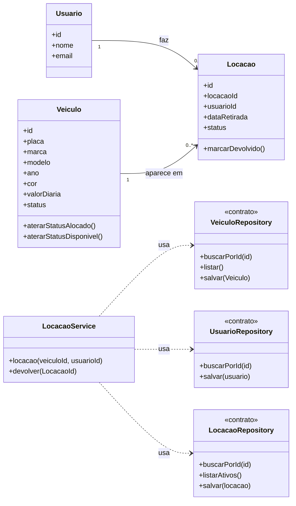

**Aluno(a):** Kayky da Costa Cajui
**Domínio:** Controle de Locadora de Veículos

## 1. O domínio

A Locadora aluga veiculos e Cada Locação registra quem pegou, qual veículo e quando.

## 2. Entidades

| Entidade | Atributos | Relacionamentos |
|---|---|---|
| Veículo | id, modelo, marca, ano, cor, placa, valorDiaria,status | aparece em várias locações |
| Usuário | id, nome, email | faz várias Locações |
| Locação | id, veiculoId, usuarioId, dataRetirada, status | pertence a um veículo e a um usuário |

## 3. Diagrama de classes



## 4. Responsabilidades

| Classe | Papel | Único motivo para mudar |
|---|---|---|
| Veiculo, Usuario, Locacao | entidades | as regras do próprio objeto
| LocacaoService | regra de negócio | o processo de Locacao e devolucao |
| VeiculoRepository, UsuarioRepository, LocacaoRepository | acesso aos dados | a forma de guardar (memória na S3, SQLite na S5) |


## 5. Onde apliquei SRP e DIP

- **SRP:** nenhuma entidade salva a si mesma. Guardar é papel dos
  repositories; o processo fica no LocacaoService.

- **DIP:** o LocacaoService depende dos contratos do repositories 
  recebidos pelo construtor. Ele não sabe se os dados estão em memória ou em um banco.

## 6. Fora do escopo (YAGNI)

Login, multas, reservas e relatórios não entram no Projeto 1.
````

Como ler o diagrama (a linguagem se chama **Mermaid**, e o GitHub desenha sozinho):

| Escrita | Significado |
|---|---|
| `class Nome { ... }` | uma classe, com atributos e métodos (um por linha) |
| `+atributo` e `+metodo()` | o `+` indica que é público |
| `<<contrato>>` | a classe é um contrato: só a lista de métodos que o service exige |
| `A "1" --> "0..*" B : faz` | relacionamento: um A para vários B |
| `A ..> B : usa` | dependência: A usa B (seta tracejada) |