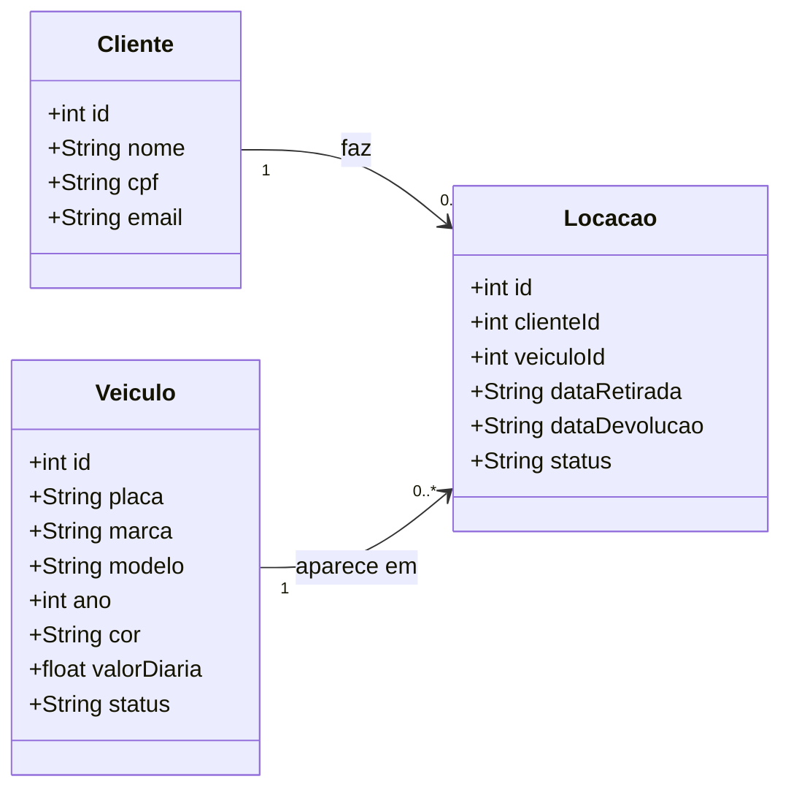
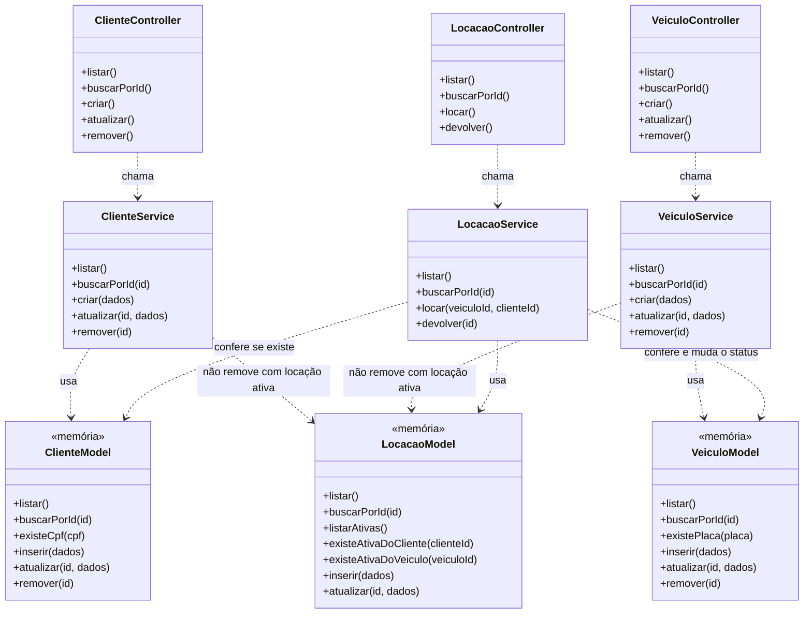

**Aluno(a):** Kayky da Costa Cajui
**Domínio:** Controle de Locadora de Veículos

## 1. O domínio

A Locadora aluga veículos. Cada Locação registra quem alugou (cliente), qual veículo e quando. O veículo só pode ser alugado se estiver disponível, e volta a ficar disponível na devolução.

## 2. Entidades

| Entidade | Atributos | Relacionamentos |
|---|---|---|
| Veículo | id, placa, marca, modelo, ano, cor, valorDiaria, status (`disponivel` \| `alocado`) | aparece em várias locações |
| Cliente | id, nome, cpf, email | faz várias locações |
| Locação | id, clienteId, veiculoId, dataRetirada, dataDevolucao, status (`ativa` \| `devolvida`) | pertence a um cliente e a um veículo |

## 3. Diagrama de classes

### 3.1 Domínio: entidades e relacionamentos

### 3.2 Camadas do backend: quem usa quem

## 4. Responsabilidades

| Camada / classe | Papel | Único motivo para mudar |
|---|---|---|
| Cliente, Veículo, Locação | entidades (dados) | os campos do próprio objeto |
| Controllers | traduzem HTTP em chamada ao service (lê `req`, devolve `res`) | o formato da requisição/resposta |
| ClienteService, VeiculoService | regras de cadastro (obrigatórios, CPF e placa únicos, diária > 0) | as regras do cadastro |
| LocacaoService | regra de negócio da locação: locar e devolver | o processo de locação e devolução |
| ClienteModel, VeiculoModel, LocacaoModel | acesso aos dados | a forma de guardar (memória na S3, SQLite na S5) |

## 5. Regras da locação (`LocacaoService`)

- **Locar** (`POST /locacoes`): cliente e veículo precisam existir (404) e o veículo precisa estar `disponivel` (409). A locação nasce `ativa` com `dataRetirada`, e o veículo passa a `alocado`.
- **Devolver** (`POST /locacoes/:id/devolucao`): só vale para locação `ativa` (409 se já devolvida). A locação vira `devolvida` com `dataDevolucao`, e o veículo volta a `disponivel`.
- O status do veículo **não** é editado à mão: só a locação o altera.
- Cliente ou veículo com locação `ativa` não pode ser removido (409).

## 6. Onde apliquei SRP e isolamento da persistência

- **SRP:** nenhuma entidade salva a si mesma. Cada camada tem um único papel: o controller cuida do HTTP, o service das regras e o model do armazenamento. O processo de locar e devolver fica só no `LocacaoService`.
- **Isolamento do armazenamento:** os services só falam com a interface dos models (`buscarPorId`, `inserir`, `atualizar`…). Na S5, trocar o array em memória por SQLite muda apenas os models.

## 7. Fora do escopo (YAGNI)

Login, multas, reservas, relatórios, edição e exclusão de locações não entram no Projeto 1.

---

Como ler os diagramas (a linguagem se chama **Mermaid**, e o GitHub desenha sozinho):

| Escrita | Significado |
|---|---|
| `class Nome { ... }` | uma classe, com atributos e métodos (um por linha) |
| `+atributo` e `+metodo()` | o `+` indica que é público |
| `<<memória>>` | estereótipo: o model guarda os dados em memória |
| `A "1" --> "0..*" B : faz` | relacionamento: um A para vários B |
| `A ..> B : usa` | dependência: A usa B (seta tracejada) |